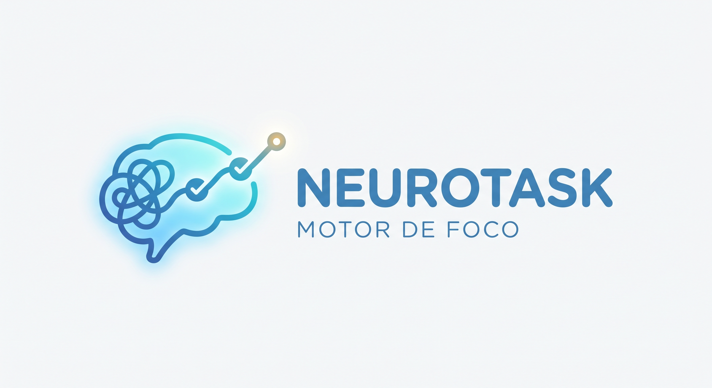
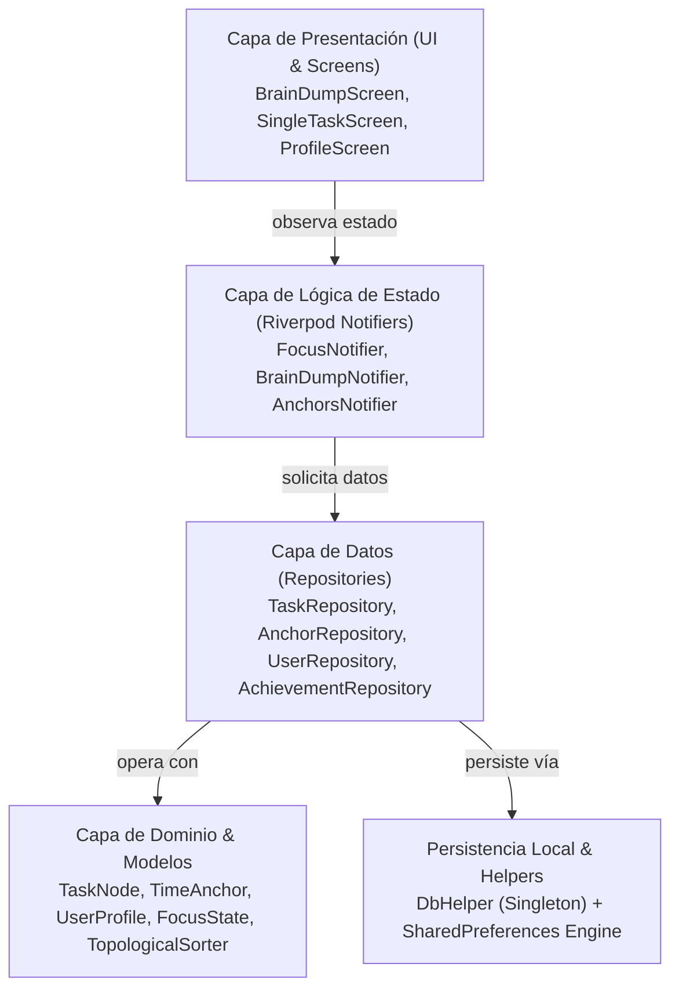

# NeuroTask: Motor de Foco 🧠✨

> **Aplicación Mobile de Descompresión Cognitiva, Secuenciación DAG y Enfoque Atómico (1 a 1)**  
> **Cátedra:** Desarrollo de Aplicaciones Móviles (DAM) — ITU, Universidad Nacional de Cuyo  
> **Evolución:** Tema 1 — *Arquitectura de Software y Capa de Datos en Flutter*  
> **Equipo:** Araujo Jonathan, Batiatto Juan Martín, Belardinelli Agustín, Ortega Mateo  
> **Repositorio GitHub:** [https://github.com/Joni23s/NeuroTask_beta00](https://github.com/Joni23s/NeuroTask_beta00)



---

## 📌 1. Visión General del Proyecto

Las aplicaciones de gestión de tareas tradicionales (Notion, Trello, Jira) trasladan tableros complejos a pantallas reducidas, generando parálisis por análisis, sobrecarga cognitiva y disfunción ejecutiva (común en estudiantes y profesionales con TDAH o fatiga mental).

**NeuroTask** reimagina la experiencia móvil a través de:
1. **Zen Splash / Bienvenida Sensorial:** Isotipo interactivo del cerebro resplandeciente con animación de respiración guiada (*Zen Breathe*).
2. **Ingesta Cruda Asíncrona (Brain Dump):** Vaciado libre de pensamientos en lenguaje natural o dictado por voz.
3. **Motor Algorítmico DAG (Directed Acyclic Graph):** Descomposición y ordenamiento topológico automático (Kahn) según dependencias y nivel de energía.
4. **Single-Task Viewport con Swipe-to-Complete:** Visualización estricta de una única tarea ejecutable a la vez, con gestos de deslizamiento con física de resorte y feedback háptico.
5. **Canvas Vectorial Interactivo del Grafo DAG:** Visualización de nodos conectados con curvas Bézier y resplandor cian del nodo activo (`CustomPainter`).
6. **Módulo de Rescate Cognitivo & Modo Baja Energía:** Subdivisión inmediata en micro-pasos de 3 minutos sin culpa.
7. **Audio Sensorial y Ruido Marrón:** Generador de audio de concentración y campanadas armónicas de gratificación.
8. **Celebración y Métricas de Calma:** Panel de refuerzo dopaminérgico con nodos conquistados y energía preservada.
9. **Estética Light Soft Paper & Soft Neumorphism:** Tonos blanco roto/gris suave (`#F4F6F9`), sombras difusas orgánicas y ausencia de alertas punitivas en rojo.

---

## 🏛️ 2. Arquitectura y Capa de Datos (Alineación Tema 1 - DAM)

Siguiendo las especificaciones técnicas de la Unidad 3.1.1 de la cátedra DAM, el proyecto implementa una arquitectura por capas desacoplada basada en el principio declarativo:

$$\text{UI} = f(\text{Estado})$$

Bajo el enfoque **Bottom-to-Top (De Abajo hacia Arriba)**, el núcleo de persistencia, las entidades tipadas y la capa de repositorios se estructuran con alta cohesión y bajo acoplamiento antes de renderizar la interfaz visual.



### 📋 Las 4 Etapas Técnicas Implementadas:

1. **Reestructuración del Proyecto (Arquitectura Base):**
   * Separación formal de responsabilidades en carpetas canónicas dentro de `lib/`: `data/`, `model/`, `core/`, `util/` y `features/`.
   * **Desacoplamiento arquitectónico:** Se extrajo `FocusState` de los controladores visuales hacia `core/domain/models/`, eliminando la dependencia circular de los servicios de almacenamiento sobre la UI.

2. **Modelado de la Información (Capa de Datos):**
   * Modelos Dart inmutables estrictamente tipados con Null Safety (`TaskNode`, `TimeAnchor`, `UserProfile`, `FocusState`, `Achievement`, `TaskGraph`).
   * **Constructores nombrados `.withId`:** Garantizan la integridad referencial al reconstruir objetos desde persistencia física.
   * **Serialización Bidireccional:** Métodos `toMap()` y `fromObject(dynamic o)` para interoperabilidad relacional plana (SQLite / clave-valor).

3. **Repositorios y Datos Dinámicos (Eliminación de Hardcodeos):**
   * **`TaskRepository`:** Gestiona el grafo de tareas y presets de volcado mental (eliminados de los controladores).
   * **`AnchorRepository`:** Envuelve a `DbHelper` (Singleton) con CRUD asíncrono (`Future<int>`, `Future<List<TimeAnchor>>`) y reemplaza las actividades hardcodeadas `_mockLunesItems` de la UI por anclas dinámicas.
   * **`UserRepository`:** Administra la entidad `UserProfile`, reemplazando todas las métricas ficticias estáticas de la pantalla de perfil y calculando subidas de nivel por tareas completadas.
   * **`AchievementRepository`:** Desacopla el catálogo de 10 logros y combina su estado con persistencia asíncrona.
   * **`providers.dart`:** Inyección de dependencias modular vía Riverpod.

4. **Integración UI - Datos (Gestión del Estado Reactiva):**
   * **Flujo Dinámico 1 (Brain Dump → Focus Session):** El usuario ingresa texto libre o carga presets del repositorio; el motor genera el grafo DAG, calza las anclas de tiempo con `AnchorRepository` y arranca la sesión. Al completar microtareas, se actualizan dinámicamente las métricas del perfil en tiempo real.
   * **Flujo Dinámico 2 (Perfil y Progresión):** `ProfileScreen` es un `ConsumerWidget` que observa reactivamente a `currentUserProfileProvider` y `userAchievementsListProvider`.
   * **Flujo Dinámico 3 (Autenticación):** `LoginRegisterScreen` conectada a `UserRepository` para login y registro persistido.

---

## 📂 3. Estructura del Repositorio

```
NeuroTask_beta00/
├── NeuroTask_logo.jpg                                       # Logotipo original
├── NeuroTask - Documento Maestro de Diseño...md             # Documento teórico completo de las 5 etapas DCU
├── README.md                                                # Documentación general y arquitectura Tema 1
├── LICENSE                                                  # Licencia MIT
│
├── web_prototype/                                           # Prototipo Interactivo Web de Alta Fidelidad
│   ├── index.html                                           # Simulador smartphone
│   ├── css/style.css                                        # Design System Soft Paper & Neumorphic Tokens
│   ├── js/dag_engine.js                                     # Motor algorítmico DAG + Topological Sort
│   ├── js/audio_engine.js                                   # Motor Web Audio API
│   └── js/app.js                                            # Lógica reactiva
│
├── flutter_app/                                             # Proyecto Flutter Completo (Clean Architecture)
│   ├── pubspec.yaml                                         # Dependencias (Riverpod, Google Fonts, etc.)
│   ├── analysis_options.yaml                                # Reglas de linting
│   ├── test/                                                # Suite de Pruebas Unitarias
│   │   ├── pure_domain_test.dart                            # Test de serialización y algoritmo DAG Kahn
│   │   ├── anchors_test.dart                                # Test de filtros y persistencia de anclas
│   │   ├── achievements_test.dart                           # Test de reglas de desbloqueo cognitivo
│   │   └── repositories_test.dart                           # 🆕 Test de Repositorios y UserProfile
│   │
│   └── lib/
│       ├── main.dart                                        # Entrypoint con ProviderScope y rutas nombradas
│       │
│       ├── model/                                           # Capa Canónica de Persistencia (Tema 1 DAM)
│       │   ├── model.dart                                   # Barrel export de entidades del sistema
│       │   ├── models.dart                                  # Barrel export alternativo canónico
│       │   └── dbhelper.dart                                # Singleton SQLite/Prefs con CRUD no bloqueante
│       │
│       ├── data/                                            # 🆕 Capa de Datos y Abstracción (Tema 1 DAM)
│       │   └── repositories/
│       │       ├── task_repository.dart                     # Repositorio de tareas y presets DAG
│       │       ├── anchor_repository.dart                   # Repositorio de anclas y malla temporal
│       │       ├── user_repository.dart                     # Repositorio de usuario y métricas
│       │       ├── achievement_repository.dart              # Repositorio de logros cognitivos
│       │       ├── providers.dart                           # Inyección de dependencias Riverpod
│       │       └── repositories.dart                        # Barrel export de repositorios
│       │
│       ├── core/
│       │   ├── domain/
│       │   │   ├── models/                                  # Entidades puras (TaskNode, TimeAnchor, UserProfile, FocusState, Achievement, TaskGraph)
│       │   │   └── services/                                # TopologicalSorter (Kahn), AnchorScheduleFitter
│       │   ├── services/                                    # Storage, Audio y Speech Services desacoplados
│       │   ├── theme/                                       # AppColors, NeumorphicTheme, ThemeController
│       │   ├── utils/                                       # HapticHelper
│       │   └── widgets/                                     # NeumorphicCard, NeumorphicButton, NeuroBadge, etc.
│       │
│       ├── util/                                            # Funciones puras independientes
│       │   ├── utils.dart                                   # Barrel export de utilidades
│       │   └── date_time_formatter.dart                     # Funciones deterministas puras de tiempo
│       │
│       └── features/                                        # Capa de Presentación (UI & Controllers)
│           ├── splash/                                      # SplashScreen
│           ├── onboarding/                                  # OnboardingScreen, WelcomeScreen
│           ├── auth/                                        # LoginRegisterScreen (conectada a UserRepository)
│           ├── brain_dump/                                  # BrainDumpScreen, VoiceDictationSheet, BrainDumpController
│           ├── focus/                                       # SingleTaskScreen, FocusController, CognitiveRescueSheet, DagCanvas
│           ├── anchors/                                     # AnchorsManagerScreen, AnchorsController (100% dinámico)
│           ├── achievements/                                # AchievementsVaultScreen, AchievementsController
│           ├── profile/                                     # ProfileScreen (ConsumerWidget dinámico)
│           └── settings/                                    # SettingsScreen
│
└── docs/
    ├── ADR-006-ARQUITECTURA-Y-CAPA-DE-DATOS-FLUTTER.md      # Persistencia, Singleton DbHelper y Capa de Datos (Unidad 3.1.1)
    ├── ADR-005-MAQUETADO-FLUTTER-Y-USABILIDAD-UN-SOLO-USUARIO.md # Maquetado, Restricciones y Usabilidad (Unidad 2.2.1)
    ├── PROTOCOLO_PRUEBA_USABILIDAD_1_USUARIO.md             # Protocolo y Guion de Prueba de Guerrilla (Steve Krug)
    ├── ADR-004-ALINEACION-PROGRAMA-DAM-FLUTTER.md           # Decisiones de Arquitectura y Alineación Rúbrica DAM
    ├── NT-SPEC-ARCH-003-TIME-ANCHORS-AND-PERSISTENCE.md     # Especificación de Anclas Temporales y Scheduler Fitter
    ├── GUIA_PRUEBA_LOCAL.md                                 # Guía de prueba local en celular vía QR
    └── FIGMA_BLUEPRINT_AND_WIREFRAMES.md                    # Blueprint para Figma y Diapositiva 6
```

---

## 🚀 4. Cómo Ejecutar el Prototipo Interactivo Web

Para abrir y probar el prototipo de forma inmediata en cualquier navegador o smartphone:

```bash
# Desde la carpeta raíz del proyecto:
python -m http.server 8080 --directory web_prototype
```
Abrí tu navegador en: **`http://localhost:8080`**

---

## 📱 5. Cómo Compilar y Ejecutar el Proyecto Flutter

El código en `flutter_app/` está listo para ser abierto en **VS Code** o **Android Studio**:

```bash
cd flutter_app

# 1. Obtener dependencias
flutter pub get

# 2. Ejecutar suite completa de pruebas unitarias
flutter test

# 3. Ejecutar en Chrome, Emulador Android o Windows Desktop
flutter run -d chrome
```

O simplemente abrí el proyecto y presioná **`F5`** en VS Code.

---

## 🎨 6. Documentación Adicional y Enlaces
* **Diseño y Blueprint Figma:** [docs/FIGMA_BLUEPRINT_AND_WIREFRAMES.md](docs/FIGMA_BLUEPRINT_AND_WIREFRAMES.md)
* **ADR Arquitectura y Capa de Datos:** [docs/ADR-006-ARQUITECTURA-Y-CAPA-DE-DATOS-FLUTTER.md](docs/ADR-006-ARQUITECTURA-Y-CAPA-DE-DATOS-FLUTTER.md)
* **Guía de Pruebas con QR en Celular:** [docs/GUIA_PRUEBA_LOCAL.md](docs/GUIA_PRUEBA_LOCAL.md)
