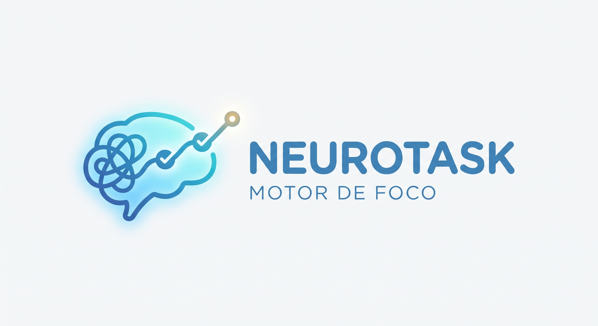
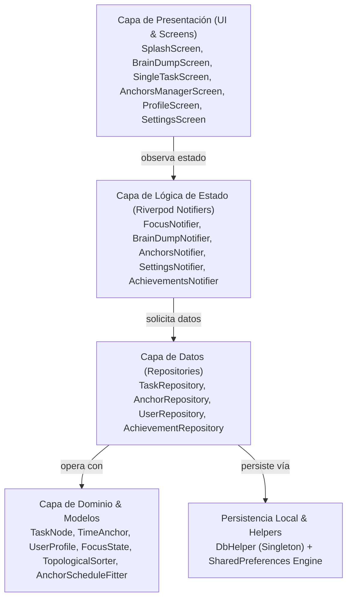

# NeuroTask: Motor de Foco 🧠✨

> **Aplicación Mobile de Descompresión Cognitiva, Secuenciación DAG y Enfoque Atómico (1 a 1)**  
> **Cátedra:** Desarrollo de Aplicaciones Móviles (DAM) — ITU, Universidad Nacional de Cuyo  
> **Evolución:** Evaluación Global Integradora (EGI) — *DCU, Maquetado Flutter, Arquitectura por Capas y Persistencia*  
> **Equipo:** Araujo Jonathan, Batiatto Juan Martín, Belardinelli Agustín, Ortega Mateo  
> **Repositorio GitHub:** [https://github.com/Joni23s/NeuroTask_beta00](https://github.com/Joni23s/NeuroTask_beta00)

## 📲 Descarga Directa (Android APK) y Demo Web

[-0F2E49?style=for-the-badge&logo=android&logoColor=white)](https://github.com/Joni23s/NeuroTask_beta00/releases/latest/download/NeuroTask.apk)
[](https://github.com/Joni23s/NeuroTask_beta00/releases/latest)
[](https://joni23s.github.io/NeuroTask_beta00/)
[](https://github.com/Joni23s/NeuroTask_beta00/actions/workflows/release-apk.yml)

- [⬇️ Descargar Último APK (Android)](https://github.com/Joni23s/NeuroTask_beta00/releases/latest/download/NeuroTask.apk) · [📦 GitHub Releases (Historial y SHA-256)](https://github.com/Joni23s/NeuroTask_beta00/releases/latest) · [🌐 Probar Web App en Vivo](https://joni23s.github.io/NeuroTask_beta00/) · [⚙️ Build Android APK](https://github.com/Joni23s/NeuroTask_beta00/actions/workflows/release-apk.yml)

| Escaneá desde tu Android | Instalación rápida en 3 pasos (sin compilar) |
| :---: | :--- |
|  | 1. **Descargá `NeuroTask.apk`** tocando el botón superior o escaneando el QR con tu teléfono.<br/>2. **Abrí el archivo e instalá** (habilitá *"Instalar apps desconocidas"* si tu navegador lo solicita).<br/>3. Si **Google Play Protect** muestra un aviso por firma académica, tocá ***Más detalles → Instalar de todas formas***. |

### 📑 Documentación Principal EGI
* **[Documento Único Integrador EGI (4 Secciones)](docs/DOCUMENTO_EGI_NEUROTASK.md)**
* **[Guía de Defensa Oral EGI](docs/GUIA_DEFENSA_ORAL_EGI.md)**
* **[Master Prompt & Catálogo para Google Stitch](STITCH_MASTER_PROMPT.md)**



---

## 📌 1. Visión General del Proyecto

Las aplicaciones de gestión de tareas tradicionales (Notion, Trello, Jira) trasladan tableros complejos a pantallas reducidas, generando parálisis por análisis, sobrecarga cognitiva y disfunción ejecutiva (común en estudiantes y profesionales con TDAH o fatiga mental).

**NeuroTask** reimagina la experiencia móvil a través de:
1. **Splash con Verificación de Sesión & Bienvenida Sensorial:** `SplashScreen` verifica `UserRepository().isLoggedIn()` para enrutar directo a `WelcomeScreen` (con isotipo cerebral *Zen Breathe* y acceso a reanudación) o al flujo de `OnboardingScreen` + `LoginRegisterScreen`.
2. **Ingesta Cruda Asíncrona (Brain Dump):** Vaciado libre de pensamientos, presets dinámicos, borrado regresivo progresivo acelerado y dictado por voz en vivo (`VoiceDictationSheet` con puente Web Speech en Chrome / `speech_to_text` nativo).
3. **Motor Algorítmico DAG & Malla Temporal `07:00–23:30`:** Ordenamiento topológico (Kahn) + `AnchorScheduleFitter` anti-solapamiento alrededor de anclas horarias editables con fechas reales de la semana actual.
4. **Single-Task Viewport con Swipe-to-Complete:** Visualización estricta de una única tarea ejecutable a la vez, alerta opcional de próxima ancla, temporizador no punitivo `ZenTimerWidget` y feedback háptico configurable.
5. **Canvas Vectorial Interactivo del Grafo DAG:** Visualización de nodos conectados con curvas Bézier, zoom/pan y resplandor del nodo activo (`DagCanvasWidget` / `_TreeDagPainter` con `CustomPainter`).
6. **Módulo de Rescate Cognitivo sin Culpa:** Subdivisión inmediata en micro-pasos de 3 minutos, Modo Baja Energía y posposición real de rama (`skipCurrentTaskToAlternativeBranch`) sin marcar la tarea como completada.
7. **Audio Sensorial & Configuración Persistente:** `SettingsNotifier` persiste Modo Oscuro, Alertas de Anclas Horarias, Ruido Marrón Automático en foco y Vibración Háptica global (`HapticHelper.enabled`).
8. **Celebración, Progreso de Perfil y Bóveda de Logros:** `CognitiveInsightCard` adaptativo, exportación de reporte Markdown, barra de nivel, racha diaria real y sincronización reactiva de los 10 logros cognitivos.
9. **Estética Light Soft Paper & Dark Soft Slate:** Superficies neumórficas (`#F4F6F9` / `#131822`), agenda semanal Deep Navy (`#0F2E49`) y ausencia total de alertas punitivas en rojo.

---

## 🏛️ 2. Arquitectura y Capa de Datos (Alineación EGI & Tema 1 - DAM)

Siguiendo las especificaciones técnicas de la cátedra DAM, el proyecto implementa una arquitectura por capas desacoplada basada en el principio declarativo:

$$\text{UI} = f(\text{Estado})$$

Bajo el enfoque **Bottom-to-Top (De Abajo hacia Arriba)**, el núcleo de persistencia, las entidades tipadas y la capa de repositorios se estructuran con alta cohesión y bajo acoplamiento antes de renderizar la interfaz visual.



### 📋 Las 4 Etapas Técnicas Implementadas:

1. **Reestructuración del Proyecto (Arquitectura Base):**
   * Separación formal de responsabilidades en carpetas canónicas dentro de `lib/`: `data/`, `model/`, `core/`, `util/` y `features/`.
   * **Desacoplamiento arquitectónico:** Se extrajo `FocusState` de los controladores visuales hacia `core/domain/models/`, eliminando dependencias circulares entre servicios de almacenamiento y la UI.

2. **Modelado de la Información (Capa de Datos):**
   * Modelos Dart inmutables estrictamente tipados con Null Safety (`TaskNode`, `TimeAnchor`, `UserProfile`, `FocusState`, `Achievement`, `TaskGraph`).
   * **Constructores nombrados `.withId`:** Garantizan la integridad referencial al reconstruir objetos desde persistencia física.
   * **Serialización Bidireccional:** Métodos `toMap()` y `fromObject(dynamic o)` para interoperabilidad relacional plana.

3. **Repositorios y Datos Dinámicos (Eliminación de Hardcodeos):**
   * **`TaskRepository`:** Gestiona el grafo de tareas y presets de volcado mental.
   * **`AnchorRepository`:** Envuelve a `DbHelper` (Singleton) con CRUD asíncrono (`Future<int>`, `Future<List<TimeAnchor>>`) alimentando la Malla Temporal `07:00–23:30` con fechas reales de la semana en curso, selector `Lun..Dom` y creación/edición/eliminación validada.
   * **`UserRepository`:** Administra `UserProfile`, autenticación local persistente (`isLoggedIn()` verificado desde `SplashScreen`), racha diaria consecutiva real, progresión de niveles (`1..4`) y migración de clave de cuenta al editar el correo desde el Perfil.
   * **`AchievementRepository` & `AchievementsNotifier`:** Desacoplan el catálogo de 10 logros y sincronizan desbloqueos y conteo único de flujos completados.
   * **`providers.dart` & `SettingsNotifier`:** Inyección de dependencias modular vía Riverpod y persistencia reactiva de preferencias (`Modo Oscuro`, `Alertas de Anclas`, `Ruido Marrón Automático`, `Vibración Háptica`).

4. **Integración UI - Datos (Gestión del Estado Reactiva):**
   * **Flujo Dinámico 1 (Brain Dump → Focus Session → Rescate):** El usuario ingresa texto o dicta por voz; `TopologicalSorter` y `AnchorScheduleFitter` generan la cola sin solapamientos; desde `CognitiveRescueSheet` puede dividir en micro-pasos (3m), activar Baja Energía o **posponer la rama actual** (`skipCurrentTaskToAlternativeBranch()`) sin marcarla completada.
   * **Flujo Dinámico 2 (Perfil y Progresión Reactiva):** `ProfileScreen` (`ConsumerWidget`) observa `currentUserProfileProvider` y `userAchievementsListProvider`, reflejando en vivo cada tarea completada, barra de nivel, racha y edición de perfil.
   * **Flujo Dinámico 3 (Autenticación y Sesión Persistente):** `SplashScreen` verifica `isLoggedIn()` para evitar repetir Onboarding/Login en sesiones abiertas, conectado a `LoginRegisterScreen` y `UserRepository`.

---

## 📂 3. Estructura del Repositorio

```
NeuroTask_beta00/
├── NeuroTask_logo.jpg                                       # Logotipo original
├── NeuroTask - Documento Maestro de Diseño...md             # Documento teórico completo de las 5 etapas DCU
├── STITCH_MASTER_PROMPT.md                                  # Master Prompt de reconstrucción UI/UX en Google Stitch
├── .stitch/SCREEN_CATALOG.md                                # Inventario verificado de 11 pantallas + 7 modales
├── README.md                                                # Documentación general y arquitectura del proyecto
├── LICENSE                                                  # Licencia MIT
│
├── .github/
│   └── workflows/
│       └── release-apk.yml                                  # Pipeline CI/CD de compilación y liberación automática de Android APK
│
├── web_prototype/                                           # Prototipo DCU Inicial (HTML/CSS/JS — antecedente de diseño)
│   ├── index.html                                           # Simulador smartphone inicial
│   ├── css/style.css                                        # Design System Soft Paper & Neumorphic Tokens
│   ├── js/dag_engine.js                                     # Motor algorítmico DAG + Topological Sort
│   ├── js/audio_engine.js                                   # Motor Web Audio API
│   └── js/app.js                                            # Lógica reactiva inicial
│
├── flutter_app/                                             # Aplicación Principal Flutter (Clean Architecture)
│   ├── pubspec.yaml                                         # Dependencias (Riverpod, Google Fonts, Audioplayers, Speech)
│   ├── analysis_options.yaml                                # Reglas de linting
│   ├── test/                                                # Suite de Pruebas (25 tests flutter test + scripts Dart)
│   │   ├── achievements_test.dart                           # Test de logros cognitivos y Baúl UI
│   │   ├── anchors_test.dart                                # Test de anclas, anti-solapamiento y DbHelper CRUD
│   │   ├── egi_features_test.dart                           # Test de SettingsNotifier, salto de rama, racha y migración
│   │   ├── pure_domain_test.dart                            # Script Dart de serialización y algoritmo DAG Kahn
│   │   ├── repositories_test.dart                           # Script Dart de Repositorios y UserProfile
│   │   └── widget_test.dart                                 # Test de modelos DAG y smoke tests de UI (Splash/Onboarding)
│   │
│   └── lib/
│       ├── main.dart                                        # Entrypoint con ProviderScope y 11 rutas nombradas
│       │
│       ├── model/                                           # Capa Canónica de Persistencia (Tema 1 DAM)
│       │   ├── model.dart                                   # Barrel export de entidades del sistema
│       │   ├── models.dart                                  # Barrel export alternativo canónico
│       │   └── dbhelper.dart                                # Singleton SharedPreferences con CRUD no bloqueante
│       │
│       ├── data/                                            # Capa de Datos y Abstracción
│       │   └── repositories/
│       │       ├── task_repository.dart                     # Repositorio de tareas y presets DAG
│       │       ├── anchor_repository.dart                   # Repositorio de anclas y malla temporal
│       │       ├── user_repository.dart                     # Repositorio de usuario, auth, racha y migración email
│       │       ├── achievement_repository.dart              # Repositorio de logros cognitivos
│       │       ├── providers.dart                           # Inyección de dependencias Riverpod
│       │       └── repositories.dart                        # Barrel export de repositorios
│       │
│       ├── core/
│       │   ├── domain/
│       │   │   ├── models/                                  # Entidades puras (TaskNode, TimeAnchor, UserProfile, FocusState, Achievement, TaskGraph)
│       │   │   └── services/                                # TopologicalSorter (Kahn), AnchorScheduleFitter
│       │   ├── services/                                    # Storage, Audio (Web/Native) y Speech Services desacoplados
│       │   ├── theme/                                       # AppColors, NeumorphicTheme, ThemeContext, ThemeController
│       │   ├── utils/                                       # HapticHelper (toggle global habilitado/deshabilitado)
│       │   └── widgets/                                     # NeumorphicCard, NeumorphicButton, NeuroInsetContainer, NeuroBadge, NeuroModalSheet, SwipeToCompleteCard, ZenTimerWidget, FlowIndicator
│       │
│       ├── util/                                            # Funciones puras independientes
│       │   ├── utils.dart                                   # Barrel export de utilidades
│       │   └── date_time_formatter.dart                     # Funciones deterministas puras de tiempo
│       │
│       └── features/                                        # Capa de Presentación (UI & Controllers)
│           ├── splash/                                      # SplashScreen (verificación de sesión isLoggedIn())
│           ├── onboarding/                                  # OnboardingScreen, WelcomeScreen
│           ├── auth/                                        # LoginRegisterScreen (conectada a UserRepository)
│           ├── brain_dump/                                  # BrainDumpScreen, VoiceDictationSheet, BrainDumpNotifier
│           ├── focus/                                       # SingleTaskScreen, SummaryCelebrationScreen, FocusNotifier, widgets/ (DagCanvasWidget, CognitiveRescueSheet, CognitiveInsightCard, GraphOverviewModal)
│           ├── anchors/                                     # AnchorsManagerScreen (Malla 07:00–23:30), AnchorsNotifier, ScheduleOverviewModal
│           ├── achievements/                                # AchievementsVaultScreen, AchievementsNotifier
│           ├── profile/                                     # ProfileScreen (nivel, racha, edición con migración)
│           └── settings/                                    # SettingsScreen, settings_controller.dart (SettingsNotifier)
│
└── docs/
    ├── DOCUMENTO_EGI_NEUROTASK.md                           # Documento Único Integrador EGI (4 Secciones)
    ├── GUIA_DEFENSA_ORAL_EGI.md                             # Guion de demo en vivo y banco de preguntas técnicas
    ├── egi_assets/                                          # Capturas reales verificadas (7 PNG) y QR de descarga directa (SVG)
    │   └── qr_apk_download.svg                              # Código QR vectorial para descargar NeuroTask.apk
    ├── ADR-006-ARQUITECTURA-Y-CAPA-DE-DATOS-FLUTTER.md      # Persistencia, Singleton DbHelper y Capa de Datos (Unidad 3.1.1)
    ├── ADR-005-MAQUETADO-FLUTTER-Y-USABILIDAD-UN-SOLO-USUARIO.md # Maquetado, Restricciones y Usabilidad (Unidad 2.2.1)
    ├── PROTOCOLO_PRUEBA_USABILIDAD_1_USUARIO.md             # Protocolo y Guion de Prueba de Guerrilla (Steve Krug)
    ├── ADR-004-ALINEACION-PROGRAMA-DAM-FLUTTER.md           # Decisiones de Arquitectura y Alineación Rúbrica DAM
    ├── NT-SPEC-CI-004-ANDROID-APK-CONTINUOUS-RELEASE.md     # Especificación CI/CD de Liberación Continua de Android APK
    ├── NT-SPEC-ARCH-003-TIME-ANCHORS-AND-PERSISTENCE.md     # Especificación de Anclas Temporales y Scheduler Fitter
    ├── GUIA_PRUEBA_LOCAL.md                                 # Guía de prueba local en celular vía QR
    └── FIGMA_BLUEPRINT_AND_WIREFRAMES.md                    # Blueprint para Figma y Diapositiva 6
```

---

## 🚀 4. Cómo Ejecutar el Prototipo DCU Inicial (`web_prototype/`)

La carpeta `web_prototype/` contiene el **prototipo interactivo HTML/CSS/JS inicial de la etapa DCU** (antecedente visual previo a la implementación completa en `flutter_app/`). Para abrirlo en cualquier navegador o smartphone:

```bash
# Desde la carpeta raíz del proyecto:
python -m http.server 8080 --directory web_prototype
```
Abrí tu navegador en: **`http://localhost:8080`**

---

## 📱 5. Cómo Compilar y Ejecutar la Aplicación Flutter (`flutter_app/`)

El código principal y evaluable en `flutter_app/` está listo para abrirse en **VS Code** o **Android Studio**:

```bash
cd flutter_app

# 1. Obtener dependencias
flutter pub get

# 2. Ejecutar suite completa de pruebas (25 tests en flutter test)
flutter test

# 3. Ejecutar scripts independientes de dominio y repositorios
dart run test/pure_domain_test.dart
dart run test/repositories_test.dart

# 4. Ejecutar en Chrome (recomendado para Web Speech en vivo), Android o Windows
flutter run -d chrome
```

O simplemente abrí el proyecto y presioná **`F5`** en VS Code.

> **¿Solo querés instalar la app en Android sin compilar?**  
> Descargá el binario compilado automáticamente en cada `push` a `main` desde **[Último `NeuroTask.apk`](https://github.com/Joni23s/NeuroTask_beta00/releases/latest/download/NeuroTask.apk)** o consultá la especificación técnica en **[NT-SPEC-CI-004](docs/NT-SPEC-CI-004-ANDROID-APK-CONTINUOUS-RELEASE.md)**.

---

## 🎨 6. Documentación Adicional y Enlaces
* **Descarga Directa de Android APK (Último Release):** [NeuroTask.apk](https://github.com/Joni23s/NeuroTask_beta00/releases/latest/download/NeuroTask.apk) · [Historial de Releases y SHA-256](https://github.com/Joni23s/NeuroTask_beta00/releases/latest)
* **Especificación CI/CD de Liberación Continua APK (SDD):** [docs/NT-SPEC-CI-004-ANDROID-APK-CONTINUOUS-RELEASE.md](docs/NT-SPEC-CI-004-ANDROID-APK-CONTINUOUS-RELEASE.md)
* **Documento Único Integrador EGI (4 Secciones):** [docs/DOCUMENTO_EGI_NEUROTASK.md](docs/DOCUMENTO_EGI_NEUROTASK.md)
* **Guía de Defensa Oral EGI:** [docs/GUIA_DEFENSA_ORAL_EGI.md](docs/GUIA_DEFENSA_ORAL_EGI.md)
* **Master Prompt & Catálogo para Google Stitch:** [STITCH_MASTER_PROMPT.md](STITCH_MASTER_PROMPT.md) · [.stitch/SCREEN_CATALOG.md](.stitch/SCREEN_CATALOG.md)
* **Diseño y Blueprint Figma:** [docs/FIGMA_BLUEPRINT_AND_WIREFRAMES.md](docs/FIGMA_BLUEPRINT_AND_WIREFRAMES.md)
* **ADR Maquetado y Usabilidad:** [docs/ADR-005-MAQUETADO-FLUTTER-Y-USABILIDAD-UN-SOLO-USUARIO.md](docs/ADR-005-MAQUETADO-FLUTTER-Y-USABILIDAD-UN-SOLO-USUARIO.md)
* **Protocolo de Prueba de Usabilidad (1 Usuario):** [docs/PROTOCOLO_PRUEBA_USABILIDAD_1_USUARIO.md](docs/PROTOCOLO_PRUEBA_USABILIDAD_1_USUARIO.md)
* **ADR Arquitectura y Capa de Datos:** [docs/ADR-006-ARQUITECTURA-Y-CAPA-DE-DATOS-FLUTTER.md](docs/ADR-006-ARQUITECTURA-Y-CAPA-DE-DATOS-FLUTTER.md)
* **Guía de Pruebas con QR en Celular:** [docs/GUIA_PRUEBA_LOCAL.md](docs/GUIA_PRUEBA_LOCAL.md)
