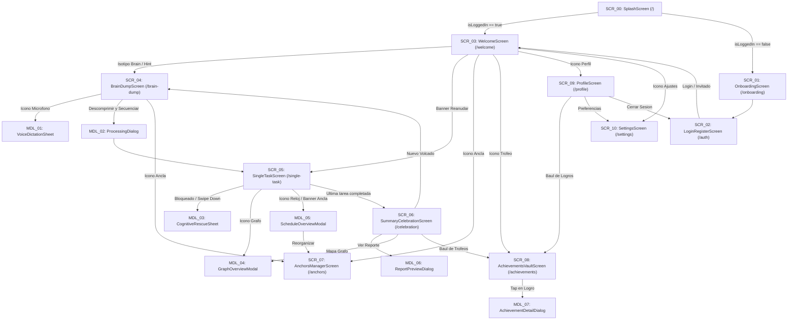
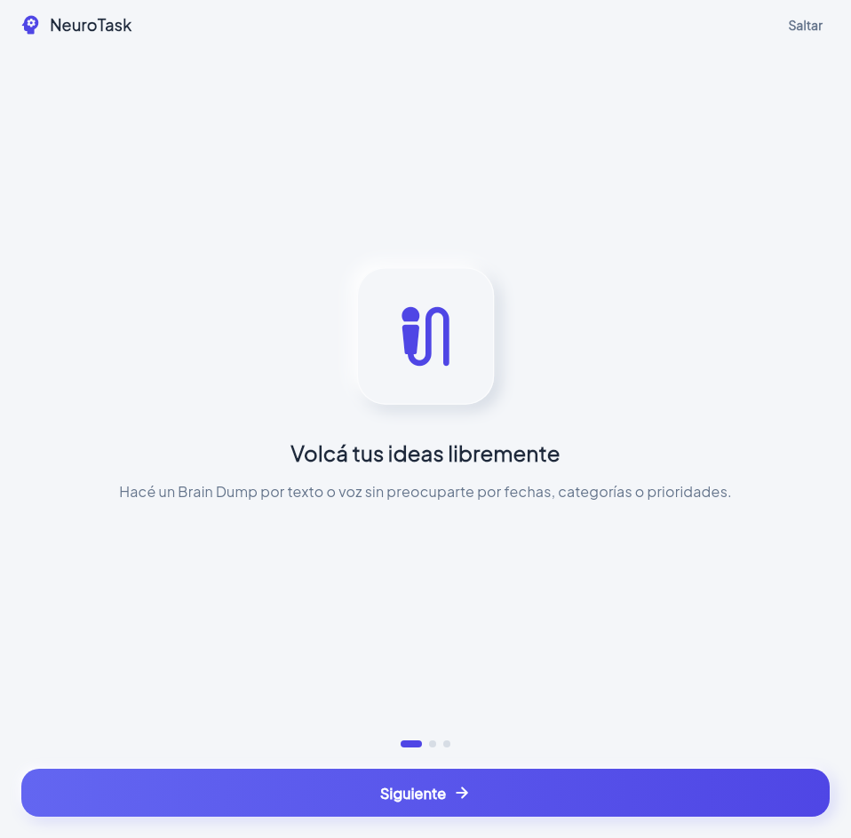
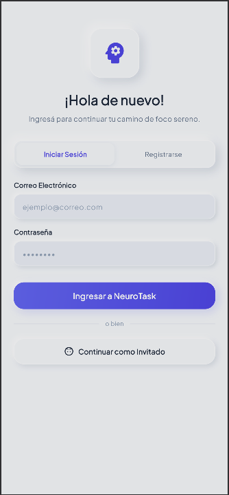
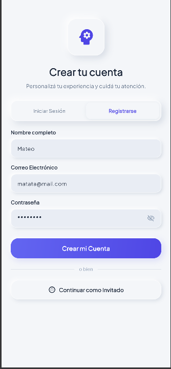
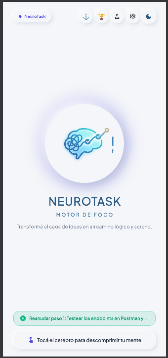
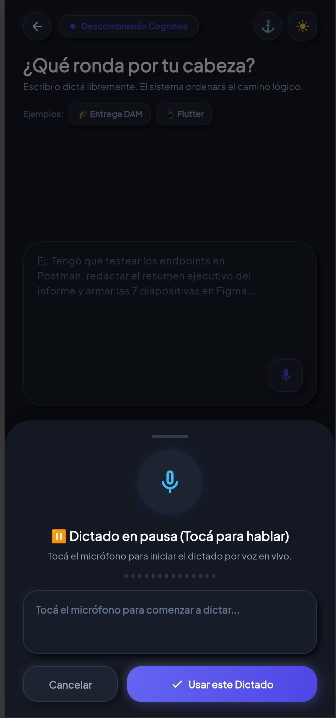
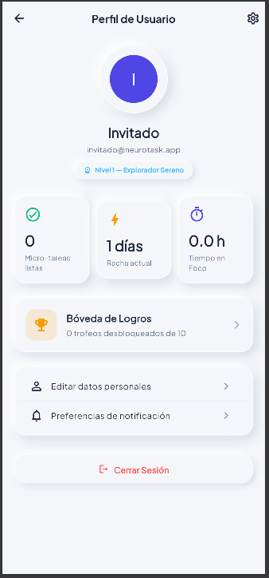
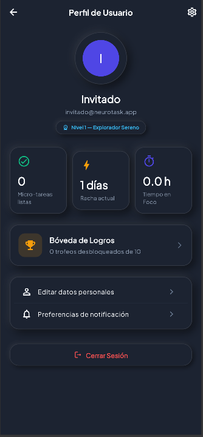

# NeuroTask: Motor de Foco — Documento Integrador EGI

| Metadata del Proyecto | Detalle |
| :--- | :--- |
| **Proyecto** | **NeuroTask: Motor de Foco** |
| **Cátedra** | Desarrollo de Aplicaciones Móviles (DAM) — Instituto Tecnológico Universitario (ITU), Universidad Nacional de Cuyo |
| **Equipo de Autores** | **Araujo Jonathan, Batiatto Juan Martín, Belardinelli Agustín, Ortega Mateo** |
| **Repositorio Oficial** | [https://github.com/Joni23s/NeuroTask_beta00](https://github.com/Joni23s/NeuroTask_beta00) |
| **Stack Tecnológico** | Flutter (Dart 3) · Riverpod (`Notifier` / `FutureProvider`) · Google Fonts (`Plus Jakarta Sans`) · `shared_preferences` · `audioplayers` · `speech_to_text` |

---

## Tabla de Contenidos

1. [Sección I. Planteamiento y justificación del problema](#sección-i-planteamiento-y-justificación-del-problema)
2. [Sección II. Diseño de la aplicación](#sección-ii-diseño-de-la-aplicación)
3. [Sección III. Implementación práctica](#sección-iii-implementación-práctica)
4. [Sección IV. Análisis crítico](#sección-iv-análisis-crítico)

---

## Sección I. Planteamiento y justificación del problema

### 1. Problema real y necesidad concreta

El ecosistema actual de aplicaciones móviles de productividad (Notion, Trello, Jira, Asana) incurre en lo que denominamos **la paradoja de la productividad móvil**: herramientas pensadas originalmente para monitores amplios de escritorio se comprimen en pantallas de 5 a 6,7 pulgadas conservando tableros Kanban densos, formularios con múltiples campos obligatorios (título, proyecto, prioridad, etiquetas, recordatorios), alertas de vencimiento en rojo punitivo y listas extensas de pendientes simultáneos.

En un dispositivo móvil usado en contexto cotidiano o académico, este diseño genera cuatro fricciones concretas:

1. **Sobrecarga sensorial y visual:** Ver 15 o 20 tarjetas compitiendo por atención en un viewport reducido satura la memoria de trabajo antes de iniciar cualquier acción.
2. **Parálisis por análisis y fricción de ingesta:** Exigir categorización, prioridad y fecha antes de capturar una idea provoca que el usuario abandone la carga o acumule notas dispersas en chats personales o papeles.
3. **Ceguera temporal (*time blindness*):** La dificultad para estimar cuánto dura realmente una secuencia de tareas frente a bloques fijos del día (clases, trabajo, entrenamiento) deriva en cronogramas irreales que se incumplen y generan culpa.
4. **Disfunción ejecutiva:** Cuando una tarea percibida como grande bloquea al usuario, las aplicaciones tradicionales no ofrecen un mecanismo empático para destrabarse sin abandonar toda la lista.

A diferencia de los gestores genéricos de listas *To-Do* vistos como ejemplos básicos de clase, **NeuroTask: Motor de Foco** no busca almacenar recordatorios pasivos ni administrar proyectos multiusuario: ataca el cuello de botella neurocognitivo previo a la ejecución mediante ingesta sin fricción, secuenciación algorítmica automática y aislamiento estricto de una única tarea en pantalla.

---

### 2. Contexto, destinatarios y síntesis DCU

El proyecto está dirigido a **estudiantes universitarios y profesionales del sector tecnológico**, con foco particular en personas neurodivergentes con **TDAH (Trastorno por Déficit de Atención e Hiperactividad)** o usuarios que atraviesan **sobrecarga cognitiva y fatiga mental**.

De acuerdo con los artefactos relevados en [NeuroTask - Documento Maestro de Diseño Centrado en el Usuario (DCU) y Arquitectura Mobile Flutter.md](../NeuroTask%20-%20Documento%20Maestro%20de%20Dise%C3%B1o%20Centrado%20en%20el%20Usuario%20%28DCU%29%20y%20Arquitectura%20Mobile%20Flutter.md), la investigación de diseño se sintetiza en los siguientes cuatro pilares:

#### 2.1 User Persona: Juan Martín
| Dimensión | Perfil Verificado |
| :--- | :--- |
| **Datos demográficos** | 23 años, estudiante de Ingeniería / Desarrollo de Software y programador freelance. |
| **Contexto neurocognitivo** | Diagnosticado con TDAH predominantemente inatento; experimenta sobrecarga sensorial en smartphones y bloqueo en la función ejecutiva al iniciar proyectos. |
| **Dispositivos y hábitos** | Uso intensivo de smartphone Android/iOS (80 a 120 consultas diarias), especialmente en traslados, pausas de estudio y momentos de procrastinación. |
| **Objetivos principales** | Iniciar entregas académicas y tareas laborales sin demoras; volcar compromisos apenas surgen sin estructurarlos en el acto; percibir avance tangible durante el día. |
| **Frustraciones y dolores** | Listados extensos con fechas vencidas en rojo; fricción de completar múltiples campos por idea; ciclo recurrente de culpa y abandono de apps de tareas al tercer día de desfasaje. |

#### 2.2 Mapa de Empatía
| Cuadrante | Hallazgos de Investigación |
| :--- | :--- |
| **¿Qué piensa y siente?** | *"Tengo mil cosas por entregar y no tengo idea de cuál es el primer paso."* · *"Me da ansiedad abrir la app porque me recuerda todo lo retrasado."* · *"Gasto más energía organizando tareas que programando."* |
| **¿Qué oye?** | Compañeros y docentes: *"Armá un cronograma y respetalo a rajatabla."* · Gurús de productividad: *"Usá Notion y sincronizalo por bloques."* · Entorno: *"Te distraés con cualquier cosa, concentrate."* |
| **¿Qué ve?** | Notificaciones intrusivas descartadas por hábito; tableros de Trello/Jira abarrotados; borradores fragmentados entre WhatsApp, cuadernos y notas rápidas. |
| **¿Qué dice y hace?** | Dice *"Hoy liquido todo"*, pero se bloquea al elegir por dónde empezar; se pierde en detalles menores; usa una app intensamente dos días y la abandona al desfasarse. |

#### 2.3 Point of View (POV) y Problem Statement
- **Point of View (POV):** Un estudiante universitario y profesional de tecnología con sobrecarga cognitiva y TDAH **necesita** una interfaz móvil que capture sus pensamientos de forma desestructurada y le presente exactamente una única micro-tarea a la vez sin fricción de configuración previa, **porque** enfrentarse visualmente a listas extensas de pendientes y categorizar manualmente fechas, prioridades y etiquetas activa disfunción ejecutiva, provocando parálisis por análisis y procrastinación evitativa.
- **Problem Statement Formal:** *"Las interfaces móviles de gestión de proyectos actuales fallan al exigir un esfuerzo de categorización y estructuración manual excesivo previo a la acción, lo cual abruma a los usuarios con sobrecarga cognitiva e interrumpe el flujo productivo natural. Se requiere un sistema móvil reactivo que automatice el desglose y ordenamiento lógico de tareas, permitiendo una ejecución atómica 1 a 1 libre de distracciones visuales."*
- **Validación DCU e iteraciones de diseño:** En el protocolo de pruebas moderadas reportado en el Documento Maestro (5 participantes sobre 3 tareas críticas), se obtuvo **100% (5/5)** en volcado + secuenciación menor a 25 s, **100% (5/5)** en comprensión del foco 1-a-1 y **80% (4/5)** en activación del rescate cognitivo. El feedback derivó en tres iteraciones concretas implementadas en el producto: (1) incorporar el indicador sutil `"Paso X de Y"` y acceso al mapa DAG para evitar sensación de "caja negra", (2) reemplazar cuentas regresivas rojas punitivas por un temporizador sereno (`ZenTimerWidget`), y (3) reformular la salida ante bloqueos sin pérdida ni eliminación de tareas (`CognitiveRescueSheet`).

---

### 3. Solución propuesta y funcionalidades implementadas

Cada módulo funcional del sistema fue verificado directamente sobre el código fuente en `flutter_app/lib/`:

1. **Splash con verificación automática de sesión (`SplashScreen`):**
   - Renderiza animación de entrada elástica y de opacidad sobre el isotipo neumórfico junto al lema `"Cero carga cognitiva. Foco puro."`.
   - Tras un temporizador de `2800 ms`, consulta asíncronamente `UserRepository().isLoggedIn()`: si existe sesión activa navega directamente a `WelcomeScreen`; en caso contrario dirige a `OnboardingScreen`.
2. **Onboarding en 3 pasos (`OnboardingScreen`):**
   - `PageView` de tres diapositivas (`"Volcá tus ideas libremente"`, `"El sistema descompone y ordena"`, `"Una sola tarea a la vez"`) con indicador animado de progreso, acceso directo `"Saltar"` y transición a autenticación.
3. **Autenticación local persistente e ingreso como Invitado (`LoginRegisterScreen` + `UserRepository`):**
   - Alternancia de pestañas `Iniciar Sesión` / `Registrarse`, validación de nombre (`>= 2` caracteres en registro), correo (`RegExp`) y contraseña (`>= 6` caracteres con alternador de visibilidad), banners de éxito/error y acceso inmediato `"Continuar como Invitado"` sin barreras de entrada.
   - Persiste cuentas registradas, sesión activa y perfil en `SharedPreferences`, incluyendo cuenta académica inicial presembrada (`estudiante.dam@itu.uncuyo.edu.ar`).
4. **Bienvenida sensorial y reanudación (`WelcomeScreen`):**
   - Centro protagonizado por el isotipo cerebral interactivo (`assets/images/brain_logo_transparent.png`) con animación continua *Zen Breathe* (ciclo sinusoidal de `3200 ms` en escala `0.96–1.04` y resplandor ambiental).
   - Barra superior con accesos a Malla Temporal (`⚓`), Baúl de Logros (`🏆`), Perfil (`👤`), Configuración (`⚙️`) y `ThemeToggleButton`.
   - Banner condicional en tiempo real (`"Reanudar paso X: ..."`) cuando `FocusState.hasActiveSession` detecta una sesión persistida pendiente.
5. **Ingesta desestructurada y dictado por voz (`BrainDumpScreen` + `VoiceDictationSheet`):**
   - Lienzo hundido (`NeuroInsetContainer` de `220 px`) para escritura libre sin formularios previos, con presets cargados asíncronamente desde `TaskRepository` (`🎓 Entrega DAM`, `📱 Flutter`; además de `examen` disponible en el repositorio).
   - Contador de palabras en vivo y botón `"Limpiar"` con algoritmo propio de **borrado regresivo progresivo acelerado** (`_buildDeconstructionSnapshots` + curva exponencial `85 ms` → `8 ms` en `_onClearText`) y feedback háptico escalonado.
   - Hoja modal `VoiceDictationSheet` con micrófono pulsante aislado en `RepaintBoundary`, visualizador de 14 barras reactivas al nivel de audio, transcripción en vivo y soporte dual: puente JavaScript `window.NeuroTaskVoice` (Web Speech API + Web Audio Analyser en `web/index.html`) para Google Chrome y plugin nativo `speech_to_text` para Android (con simulación asistida en Windows desktop cuando el micrófono nativo no está disponible).
6. **Motor algorítmico DAG y ajuste temporal anti-solapamiento (`TopologicalSorter` + `AnchorScheduleFitter`):**
   - `TopologicalSorter.parseRawText()`: fragmenta texto libre mediante conectores y puntuación (`RegExp`), clasifica cada cláusula en categorías (`Estudio & Idiomas`, `Backend & Dev`, `Documentación`, `Diseño & UI`, `Gestión Rápida`, `Ejecución`), asigna duración estimada y `EnergyLevel`, y construye un Grafo Acíclico Dirigido (`TaskGraph` de hasta 6 nodos conectados).
   - `TopologicalSorter.sort()`: aplica el **algoritmo de Kahn** (cálculo de grados de entrada `inDegree` y cola FIFO) para garantizar un orden de ejecución válido libre de dependencias bloqueadas.
   - `AnchorScheduleFitter.fitTasks()`: ubica cada tarea en ventanas libres del día evitando colisiones con las anclas horarias activas (`bufferMinutesBetweenTasks = 5`), saltando al cierre de cada ancla que se interponga y emitiendo diagnóstico de viabilidad o alerta si excede las `23:30` (`dayLimitMinutes = 1410`).
7. **Viewport estricto 1-a-1 y Rescate Cognitivo (`SingleTaskScreen`):**
   - Muestra únicamente la tarea activa (`Paso X de Y` mediante `FlowIndicator`) dentro de `SwipeToCompleteCard`: deslizar hacia la derecha (`>= 140 px`) completa el paso y deslizar hacia abajo (`>= 70 px`) abre el rescate cognitivo.
   - Integra `ZenTimerWidget` (pulso orgánico no punitivo + cronómetro `mm:ss` con etiqueta `"| Sin apuros"`), toggle manual o automático de Ruido Marrón (`AudioServiceNotifier`), alerta condicional de próxima ancla horaria (`"⚓ Próxima ancla: ..."`), `GraphOverviewModal` (con alternancia entre lista ordenada y canvas vectorial 2D `DagCanvasWidget` pintado con `_TreeDagPainter` usando curvas Bézier cúbicas y nodo activo pulsante), `ScheduleOverviewModal` (proyección horaria integrada con anclas intermedias) y `CognitiveRescueSheet` con 3 rescates sin culpa:
     1. **Subdividir en micro-pasos de 3 min (`splitCurrentTask`):** reemplaza el nodo actual por dos micro-pasos inmediatos (`3 min` de preparación y `5 min` de acción).
     2. **Activar Modo Baja Energía (`activateLowEnergyMode`):** reordena las tareas pendientes priorizando las de menor `EnergyLevel`.
     3. **Saltar a rama independiente (`skipCurrentTaskToAlternativeBranch`):** pospone la tarea actual al final de la cola pendiente sin marcarla como completada, permitiendo avanzar por otra rama desbloqueada.
8. **Malla Temporal semanal (`AnchorsManagerScreen`):**
   - Canvas nocturno calmante (`#0F2E49`) con selector horizontal `Lun..Dom`, bloque superior izquierdo con la fecha calendario real de la semana en curso (`DateTime.now()`), eje horario vertical de `7:00` a `23:00` (con cobertura hasta las `23:30`) y tarjetas escalonadas en Teal/Lavender.
   - CRUD completo conectado a `AnchorsNotifier` → `AnchorRepository` → `DbHelper`: crear, inspeccionar detalle, editar y eliminar anclas mediante `_AddAnchorForm` con validación `Form`, `FilterChip` por días de la semana, `showTimePicker`, selector de categoría y verificación de rango horario (`endMins > startMins`).
9. **Celebración, Bóveda de Logros, Perfil y Configuración:**
   - `SummaryCelebrationScreen`: métricas reales (`Nodos Logrados`, `Tiempo Real`, `Calma Mental 100%`), `CognitiveInsightCard` dual según ritmo (Hiperfoco, Persistencia o Precisión Armónica), diálogo monoespaciado `ReportPreviewDialog` y copia de reporte Markdown al portapapeles.
   - `AchievementsVaultScreen`: bóveda de **10 logros curados** en 5 categorías (`foco`, `resiliencia`, `calma`, `exploracion`, `maestria`) con barra de progreso, filtros y `AchievementDetailDialog` con impacto neuro-cognitivo.
   - `ProfileScreen`: niveles progresivos 1 a 4 (`0 / 10 / 20 / 30` tareas completadas), barra de progreso hacia el siguiente nivel, racha diaria real calculada por fechas consecutivas (`_keyLastActivityDate`), edición de nombre y correo con migración de clave de cuenta (`updateProfile(..., previousEmail: ...)`), y cierre de sesión.
   - `SettingsScreen` + `SettingsNotifier`: interruptores persistentes en `SharedPreferences` para Modo Oscuro Soft Slate (`themeProvider`), Alertas de Anclas Horarias (`anchorNotifications`), Ruido Marrón Automático (`autoBrownNoise`) y Vibración Háptica global (`hapticFeedback` sincronizada con `HapticHelper.enabled`).

---

## Sección II. Diseño de la aplicación

### 1. Flujo de navegación, inventario de superficies y recorridos

La navegación centralizada en `NeuroTaskApp` (`flutter_app/lib/main.dart`) combina rutas nombradas con transiciones modales tipo `BottomSheet` y `Dialog`, conservando una jerarquía plana de baja fricción cognitiva:



#### 1.1 Matriz completa de pantallas y superficies modales (11 Full-Screen + 7 Modales)

Verificada directamente en [.stitch/SCREEN_CATALOG.md](../.stitch/SCREEN_CATALOG.md), [flutter_app/lib/main.dart](../flutter_app/lib/main.dart) y los archivos de `features/`:

| ID | Nombre en Código | Ruta / Acceso | Tipo | Responsabilidad y Componentes Clave |
| :--- | :--- | :--- | :--- | :--- |
| `SCR_00` | `SplashScreen` | `/` (Inicial) | Full Screen | Logo neumórfico animado, lema sereno y verificación asíncrona `UserRepository.isLoggedIn()`. |
| `SCR_01` | `OnboardingScreen` | `/onboarding` | Full Screen | `PageView` de 3 pasos, dots animados, CTA `"Saltar"`, `"Siguiente"` / `"Comenzar"`. |
| `SCR_02` | `LoginRegisterScreen` | `/auth` | Full Screen | Tabs `Iniciar Sesión` / `Registrarse`, validación activa, banner de éxito/error e ingreso `"Continuar como Invitado"`. |
| `SCR_03` | `WelcomeScreen` | `/welcome` | Full Screen | Barra superior (`⚓`, `🏆`, `👤`, `⚙️`, tema), isotipo cerebral *Zen Breathe* (210x210), banner condicional de reanudación. |
| `SCR_04` | `BrainDumpScreen` | `/brain-dump` | Full Screen | Presets (`🎓 Entrega DAM`, `📱 Flutter`), área `NeuroInsetContainer`, contador de palabras, borrado regresivo acelerado y CTA secuenciador. |
| `SCR_05` | `SingleTaskScreen` | `/single-task` | Full Screen | `FlowIndicator`, controles sensoriales, alerta condicional de ancla, `SwipeToCompleteCard`, `ZenTimerWidget`, botones de avance y rescate. |
| `SCR_06` | `SummaryCelebrationScreen` | `/celebration` | Full Screen | 3 métricas medidas, `CognitiveInsightCard`, exportación Markdown al portapapeles, acceso a reporte, grafo, baúl y nuevo volcado. |
| `SCR_07` | `AnchorsManagerScreen` | `/anchors` | Full Screen | Lienzo Navy `#0F2E49`, selector `Lun..Dom`, fecha semanal real, eje `7:00–23:00` (hasta `23:30`), tarjetas Teal/Lavender y CRUD completo. |
| `SCR_08` | `AchievementsVaultScreen` | `/achievements` | Full Screen | Barra de progreso (`X de 10 Conquistados`), 6 pills de filtro (Todos + 5 categorías), listado de 10 trofeos. |
| `SCR_09` | `ProfileScreen` | `/profile` | Full Screen | Avatar por iniciales, badge de nivel (`Nivel 1..4`), barra hacia siguiente nivel, 3 métricas reales, acceso al baúl, edición modal y logout. |
| `SCR_10` | `SettingsScreen` | `/settings` | Full Screen | 4 switches persistentes (`Modo Oscuro`, `Alertas de Anclas Horarias`, `Ruido Marrón Automático`, `Vibración Háptica`) e info técnica. |
| `MDL_01` | `VoiceDictationSheet` | BottomSheet desde `SCR_04` | Modal BottomSheet | Micrófono pulsante 86 px, 14 barras de onda sonora, transcripción en vivo y confirmación `"Usar este Dictado"`. |
| `MDL_02` | `ProcessingDialog` | Dialog desde `SCR_04` | Modal Dialog | Indicador sereno durante `TopologicalSorter` + `AnchorScheduleFitter`. |
| `MDL_03` | `CognitiveRescueSheet` | BottomSheet desde `SCR_05` | Modal BottomSheet | 3 rescates: micro-pasos 3m, Modo Baja Energía y saltar/posponer rama sin completar. |
| `MDL_04` | `GraphOverviewModal` | BottomSheet desde `SCR_05`/`SCR_06` | Modal BottomSheet | Alternancia `Ver Grafo` (`DagCanvasWidget` con `_TreeDagPainter`) / `Ver Lista`. |
| `MDL_05` | `ScheduleOverviewModal` | BottomSheet desde `SCR_05` | Modal BottomSheet | Banner de viabilidad/sobrecarga (`AnchorScheduleFitter`), lista cronológica con barras de anclas y botón `"Reorganizar"`. |
| `MDL_06` | `ReportPreviewDialog` | Dialog desde `SCR_06` | Modal Dialog | Vista previa monoespaciada del reporte Markdown y botón `"Copiar al Portapapeles"`. |
| `MDL_07` | `AchievementDetailDialog` | Dialog desde `SCR_08` | Modal Dialog | Medalla 76 px, estado (`✨ DESBLOQUEADO` / `🔒 BLOQUEADO`) e `"Impacto Neuro-Cognitivo"`. |

#### 1.2 Recorridos principales del usuario
1. **Primer ingreso:** `SplashScreen` (`isLoggedIn == false`) → `OnboardingScreen` (3 slides o `"Saltar"`) → `LoginRegisterScreen` (Registro, Login o `"Continuar como Invitado"`) → `WelcomeScreen`.
2. **Retorno con sesión activa:** `SplashScreen` (`isLoggedIn == true`) → `WelcomeScreen` (si `focusProvider` restauró tareas desde `SessionStorageService`, muestra el banner esmeralda `"Reanudar paso X"` para saltar directo a `SingleTaskScreen`).
3. **Flujo de Foco 1-a-1:** `WelcomeScreen` → `BrainDumpScreen` (escritura, dictado por voz `VoiceDictationSheet` o preset) → `ProcessingDialog` → `SingleTaskScreen` (avance paso a paso mediante swipe o botón) → `SummaryCelebrationScreen` (reporte, insights y desbloqueo de logros).
4. **Rescate Cognitivo ante bloqueo:** En `SingleTaskScreen`, el usuario desliza hacia abajo o pulsa `"Estoy Bloqueado / Dividir más"` → `CognitiveRescueSheet` → elige subdividir en micro-pasos (`3m`), reordenar por baja energía o posponer la tarea actual hacia otra rama independiente.
5. **Gestión de Malla Temporal:** Desde `WelcomeScreen`, `BrainDumpScreen` (`⚓`) o `ScheduleOverviewModal` (`"Reorganizar"`) → `AnchorsManagerScreen` → selecciona día de la semana, inspecciona anclas existentes (editar/eliminar) o crea una nueva con `+`.
6. **Perfil, Logros y Ajustes:** Desde `WelcomeScreen` (`👤` / `⚙️` / `🏆`) → `ProfileScreen` (edita nombre/correo en bottom sheet, consulta progreso de nivel y racha o cierra sesión), `SettingsScreen` (configura tema, alertas, ruido automático y háptica) y `AchievementsVaultScreen`.

---

### 2. Diseño de pantallas clave, wireframes y prototipo Google Stitch

> [!IMPORTANT]
> **Prototipo Interactivo en Google Stitch (Completar URL Pública):**  
> **[Enlace al Prototipo Interactivo en Google Stitch — Completar con URL pública]**  
> *Generado y alineado 100% a partir de [STITCH_MASTER_PROMPT.md](../STITCH_MASTER_PROMPT.md) y [.stitch/SCREEN_CATALOG.md](../.stitch/SCREEN_CATALOG.md). Como antecedentes DCU previos dentro del repositorio se conservan también el blueprint de wireframes [docs/FIGMA_BLUEPRINT_AND_WIREFRAMES.md](FIGMA_BLUEPRINT_AND_WIREFRAMES.md) y el simulador inicial en [web_prototype/](../web_prototype/index.html).*

#### 2.1 Wireframes estructurales de las pantallas clave

```text
+----------------------------------+     +----------------------------------+
|  [• NeuroTask]  [⚓][🏆][👤][⚙️][🌙] |     |  (<-) [• Descompresión...] [⚓][🌙] |
|                                  |     |                                  |
|                                  |     |  ¿Qué ronda por tu cabeza?       |
|            . - - - .             |     |  Escribí o dictá libremente...   |
|         .'           '.          |     |  Ejemplos: [🎓 DAM] [📱 Flutter] |
|        /   ( 🧠 )      \         |     |  +----------------------------+  |
|        \   Zen Breathe /         |     |  | Ej: Tengo que testear los  |  |
|         '.           .'          |     |  | endpoints en Postman...    |  |
|            ' - - - '             |     |  |                            |  |
|                                  |     |  |                      [🎙️]  |  |
|           NEUROTASK              |     |  +----------------------------+  |
|         MOTOR DE FOCO            |     |  18 palabras          [Limpiar]  |
|  Transformá el caos de ideas...  |     |                                  |
|                                  |     |  +----------------------------+  |
|  [▶ Reanudar paso 1: ...]        |     |  | Descomprimir y Secuenciar ->| |
|  [👆 Tocá el cerebro para...]    |     |  +----------------------------+  |
+----------------------------------+     +----------------------------------+
       SCR_03: WelcomeScreen                    SCR_04: BrainDumpScreen

+----------------------------------+     +----------------------------------+
| [• Paso 1 de 3]  [☁][🕒][☍][✿][🌙]|     |  (<-)   [💡] MALLA TEMPORAL (+)  |
|  ESTÁS ENFOCADO EN ESTO AHORA:   |     |  [Lun][Mar][Mié][Jue][Vie][Sáb]  |
|  [⚓ Próxima ancla: 17:30-19:30] |     |  LUNES                           |
|                                  |     |   23   |                         |
|  +----------------------------+  |     |  NOV   |-------------------------|
|  | ====                       |  |     |  7:00  |  +-----------+          |
|  | BACKEND     [⏰14:00]      |  |     |  8:00  |--| Facultad  |          |
|  |                            |  |     |  9:00  |  | DAM       | +------+ |
|  | Testear los endpoints en   |  |     |        |  +-----------+ | Rev. | |
|  | Postman y verificar JSON   |  |     | 10:00  |                | Proy.| |
|  | -------------------------- |  |     |        |  +-----------+ +------+ |
|  | (•) Flujo: 15m  00:42|Sin  |  |     | 11:00  |--| Llamada   |          |
|  +----------------------------+  |     |        |  +-----------+          |
|     👉 Deslizá para completar    |     | 22:00  |  [Cena y Desconexión]    |
|  [ ✓ Paso Completado          ]  |     |  Navy #0F2E49 · Teal / Lavender  |
|  [ ? Estoy Bloqueado / Dividir]  |     +----------------------------------+
|     SCR_05: SingleTaskScreen              SCR_07: AnchorsManagerScreen
```

#### 2.2 Capturas reales de la aplicación implementada

Las siguientes capturas fueron tomadas directamente desde la compilación funcional de Flutter y almacenadas en `docs/egi_assets/`:

| Flujo Inicial (`SCR_01` Onboarding) | Acceso (`SCR_02` Login) | Registro (`SCR_02` Register) |
| :---: | :---: | :---: |
|  |  |  |
| *Slide 1/3 en Light Soft Paper con tarjeta neumórfica y CTA índigo.* | *Tabs neumórficas, inputs hundidos e ingreso como Invitado.* | *Formulario de registro con nombre, correo y toggle de contraseña.* |

| Bienvenida (`SCR_03` Welcome) | Ingesta & Voz (`SCR_04` + `MDL_01`) | Perfil Claro (`SCR_09`) | Perfil Oscuro (`SCR_09`) |
| :---: | :---: | :---: | :---: |
|  |  |  |  |
| *Isotipo cerebral Zen Breathe, barra superior y banner de reanudación.* | *Dark Soft Slate con área de texto hundida y hoja modal de dictado por voz.* | *Perfil en Light Soft Paper mostrando métricas y acceso a logros.* | *Mismo perfil en Dark Soft Slate manteniendo contraste y relieve.* |

---

### 3. Criterio visual coherente

El sistema visual se basa en **Soft Neumorphism** combinado con dos lienzos principales (**Light Soft Paper** y **Dark Soft Slate**) más un tema específico nocturno Navy para la planificación diaria de anclas. Todos los valores exactos fueron verificados en [app_colors.dart](../flutter_app/lib/core/theme/app_colors.dart), [neumorphic_theme.dart](../flutter_app/lib/core/theme/neumorphic_theme.dart) y [anchors_manager_screen.dart](../flutter_app/lib/features/anchors/anchors_manager_screen.dart).

#### 3.1 Paleta cromática exacta

| Categoría / Rol | Token en Código | Valor Hex / RGBA | Uso en la Interfaz |
| :--- | :--- | :--- | :--- |
| **Fondo Claro** | `AppColors.background` | `#F4F6F9` | Lienzo *Light Soft Paper*; evita deslumbramiento de `#FFFFFF`. |
| **Superficie Card Clara** | `AppColors.cardSurface` | `#F4F6F9` | Tarjetas y botones elevados por doble sombra. |
| **Superficie Hundida Clara** | `AppColors.pressedSurface` | `#E9EDF4` | Campos de texto, *Brain Dump*, contenedores inset. |
| **Fondo Oscuro** | `AppColors.darkBackground` | `#131822` | Lienzo *Dark Soft Slate* para baja fatiga ocular nocturna. |
| **Card Oscura** | `AppColors.darkCardSurface` | `#1C2331` | Tarjetas elevadas en modo oscuro. |
| **Superficie Hundida Oscura** | `AppColors.darkPressedSurface` | `#161C28` | Pozos de texto y controles presionados en modo oscuro. |
| **Azul Marca** | `AppColors.brandDeepBlue` | `#2B5B84` | Títulos de marca (`NEUROTASK`), acentos de foco en modo claro. |
| **Azul Acero** | `AppColors.brandSteelBlue` | `#4A7D9D` | Subtítulos (`MOTOR DE FOCO`), barras e íconos de anclas. |
| **Cian Resplandor** | `AppColors.brandGlowCyan` | `#38BDF8` | Halo de nodo DAG activo, texto destacado en modo oscuro y spinner. |
| **Cian Lavado** | `AppColors.brandGlowLight` | `#E0F2FE` | Fondos suaves de destaque cian. |
| **Índigo Primario** | `AppColors.primaryIndigo` / `Light` | `#4F46E5` / `#6366F1` | Gradiente de CTAs principales, tab activo, temporizador zen. |
| **Esmeralda Éxito** | `AppColors.successEmerald` / `Dark` | `#10B981` / `#059669` | Gradiente de `"Paso Completado"`, swipe reveal y barras de logro. |
| **Ámbar Rescate** | `AppColors.amberWarning` / `Light` / `Dark` | `#F59E0B` / `#FEF3C7` / `#D97706` | Botón de rescate cognitivo, pills `"Micro-Paso (3m)"` y advertencias suaves. |
| **Tipografía Clara / Oscura** | `textMain` / `darkTextMain` | `#1E293B` / `#F8FAFC` | Títulos y cuerpo principal de alta legibilidad. |
| **Tipografía Secundaria / Muted** | `textSecondary` / `textMuted` | `#64748B` / `#94A3B8` | Subtítulos, ayudas y metadatos (invertidos en modo oscuro). |
| **Malla Temporal Navy** | `backgroundColor` (`AnchorsManager`) | `#0F2E49` | Lienzo nocturno exclusivo de la agenda semanal `07:00–23:30`. |
| **Malla Temporal Tarjetas** | Teal / Lavender / Accent | `#72B8B0` (`#132B33`) / `#B48BB6` (`#28182E`) / `#45A59E` | Bloques escalonados de actividades, eje vertical y chips activos. |

#### 3.2 Tipografía, iconografía y elevación neumórfica
- **Tipografía:** `Plus Jakarta Sans` aplicada globalmente mediante `GoogleFonts.plusJakartaSansTextTheme()` en `NeumorphicTheme` (`displayLarge` 26px bold, `titleLarge` 20px bold, `titleMedium` 16px w600, `bodyLarge` 14px, `bodyMedium` 13px, `bodySmall` 11px). Para temporizadores (`ZenTimerWidget`), horas del eje (`AnchorsManagerScreen`) y vista previa de reportes (`ReportPreviewDialog`) se utiliza fuente monoespaciada (`Courier` / `monospace`).
- **Iconografía:** Familia `Material Icons Rounded` combinada con emojis semánticos puntuales (`🧠`, `⚓`, `🏆`, `🎯`, `🌱`, `🌿`, `⚡`, `🎙️`, `🌧️`) para reforzar reconocimiento rápido sin sobrecarga textual.
- **Sombras neumórficas dobles (`NeumorphicTheme`):**
  - **Modo Claro:** `softElevation` combina sombra inferior derecha `AppColors.shadowDark` (`0x73A6B2C4`, offset `(6, 6)`, blur `14`) y luz superior izquierda `AppColors.shadowLight` (`#FFFFFF`, offset `(-6, -6)`, blur `14`); `subtleElevation` usa offsets `(3, 3)` / `(-3, -3)` con blur `8`; `pressedElevation` usa `0x66A6B2C4` y `#FFFFFF` con blur `6`.
  - **Modo Oscuro:** `darkSoftElevation` combina `darkShadowDark` (`0x99000000`, `(6, 6)`, blur `16`) y `darkShadowLight` (`0x14FFFFFF`, `(-4, -4)`, blur `12`); `darkSubtleElevation` usa blur `8`/`6` y `darkPressedElevation` usa `0xCC000000` / `0x0DFFFFFF`.

---

## Sección III. Implementación práctica

### 1. Repositorio GitHub, pruebas y guía de ejecución

- **Repositorio oficial:** [https://github.com/Joni23s/NeuroTask_beta00](https://github.com/Joni23s/NeuroTask_beta00)

Pasos reproducibles para clonar, validar y ejecutar la aplicación móvil Flutter:

```bash
# 1. Clonar el repositorio oficial e ingresar al proyecto Flutter
git clone https://github.com/Joni23s/NeuroTask_beta00.git
cd NeuroTask_beta00/flutter_app

# 2. Descargar dependencias definidas en pubspec.yaml
flutter pub get

# 3. Ejecutar análisis estático (reglas de flutter_lints)
flutter analyze

# 4. Ejecutar las suites automatizadas de flutter_test (25 casos verificados en test/)
flutter test

# 5. Ejecutar en Google Chrome o dispositivo/emulador Android conectado
flutter run -d chrome
# Compilación Android Release:
flutter build apk --release
```

#### Inventario verificado de pruebas en `flutter_app/test/`
En el directorio `flutter_app/test/` se verificaron **6 archivos de prueba**:
- **4 suites `flutter_test` con 25 casos (`test()` / `testWidgets()`):**
  - `achievements_test.dart` (4 tests): catálogo de 10 logros, serialización JSON, `AchievementsNotifier` y smoke test de `AchievementsVaultScreen`.
  - `anchors_test.dart` (11 tests): `TimeAnchor` JSON, constructores `.withId`, `DateTimeFormatter`, algoritmo anti-solapamiento `AnchorScheduleFitter` (salto de anclas y sobrecarga), Singleton `DbHelper`, `toMap()`/`fromObject()` y ciclo CRUD completo.
  - `egi_features_test.dart` (6 tests): persistencia en `SettingsNotifier` + `HapticHelper.enabled`, posposición de rama en `FocusNotifier`, conteo único de flujos en `AchievementsNotifier`, migración de correo en `UserRepository.updateProfile`, racha diaria y progresión de nivel.
  - `widget_test.dart` (4 tests): serialización `TaskNode`/`TaskGraph`, orden topológico `TopologicalSorter`, smoke test de `NeuroTaskApp` (`SplashScreen` con temporizador) y `OnboardingScreen`.
- **2 scripts independientes de verificación en Dart puro:** `pure_domain_test.dart` y `repositories_test.dart` (ejecutables con `dart run`).

---

### 2. Estructura técnica y aclaración de carpetas

```text
flutter_app/
├── pubspec.yaml                        # Riverpod ^2.5.1, google_fonts, audioplayers, shared_preferences, speech_to_text
├── analysis_options.yaml               # Linter con flutter_lints + prefer_const_constructors / declarations
├── web/index.html                      # Puente JS Web Speech + Web Audio (solo para ejecución en Chrome)
├── assets/
│   ├── audio/                          # brown_noise_loop.wav, zen_chime.wav (reproducción nativa Android)
│   └── images/                         # brain_logo_transparent.png, logo.jpg
├── test/                               # 6 archivos de prueba (25 casos flutter_test + 2 scripts Dart)
└── lib/
    ├── main.dart                       # Punto de entrada con ProviderScope y 11 rutas nombradas
    ├── model/
    │   ├── dbhelper.dart               # Singleton de persistencia local CRUD para anclas horarias
    │   ├── model.dart                  # Barrel export de entidades de dominio
    │   └── models.dart                 # Barrel export alternativo canónico (Unidad 3.1.1 DAM)
    ├── util/
    │   ├── date_time_formatter.dart    # Funciones puras deterministas de días, horas y duraciones
    │   └── utils.dart                  # Barrel export de utilidades y HapticHelper
    ├── data/repositories/
    │   ├── task_repository.dart        # Presets de Brain Dump, grafo inicial y persistencia de sesión
    │   ├── anchor_repository.dart      # CRUD de anclas y Malla Temporal sobre DbHelper
    │   ├── user_repository.dart        # Auth local, invitado, racha diaria, niveles y migración de correo
    │   ├── achievement_repository.dart # Catálogo de 10 logros e hidratación desde almacenamiento
    │   ├── providers.dart              # Providers Riverpod de repositorios y FutureProviders reactivos
    │   └── repositories.dart           # Barrel export de la capa de datos
    ├── core/
    │   ├── domain/
    │   │   ├── models/                 # TaskNode, TaskGraph/TaskEdge, TimeAnchor, UserProfile, FocusState, Achievement
    │   │   └── services/               # TopologicalSorter (Kahn DAG), AnchorScheduleFitter
    │   ├── services/                   # AudioService, SpeechService, SessionStorage, AchievementsStorage, Web Bridges
    │   ├── theme/                      # AppColors, NeumorphicTheme, ThemeContext, ThemeNotifier
    │   ├── utils/                      # HapticHelper (controlado por HapticHelper.enabled)
    │   └── widgets/                    # NeumorphicCard, NeumorphicButton, NeuroInsetContainer, NeuroBadge,
    │                                   # NeuroModalSheet, SwipeToCompleteCard, ZenTimerWidget, FlowIndicator, ThemeToggleButton
    └── features/
        ├── splash/                     # splash_screen.dart
        ├── onboarding/                 # onboarding_screen.dart, welcome_screen.dart
        ├── auth/                       # login_register_screen.dart
        ├── brain_dump/                 # brain_dump_screen.dart, brain_dump_controller.dart, voice_dictation_sheet.dart
        ├── focus/                      # focus_controller.dart, single_task_screen.dart, summary_celebration_screen.dart
        │   └── widgets/                # cognitive_rescue_sheet.dart, graph_overview_modal.dart, dag_canvas_widget.dart, cognitive_insight_card.dart
        ├── anchors/                    # anchors_controller.dart, anchors_manager_screen.dart, schedule_overview_modal.dart
        ├── achievements/               # achievements_controller.dart, achievements_vault_screen.dart
        ├── profile/                    # profile_screen.dart
        └── settings/                   # settings_controller.dart, settings_screen.dart
```

> [!NOTE]
> **Aclaración arquitectónica sobre carpetas web y prototipo:**
> 1. **`flutter_app/`** aloja la aplicación completa 100% desarrollada en **Flutter/Dart** para Android y Web.
> 2. **`flutter_app/web/index.html`** contiene únicamente un puente JavaScript mínimo (`window.NeuroTaskVoice` con Web Speech API + Web Audio Analyser, y `window.NeuroTaskAudio` con síntesis de ruido marrón y campanada a 528 Hz) conectado mediante compilación condicional (`dart:js_interop` en `web_speech_bridge_web.dart` / `web_audio_bridge_web.dart` vs. stubs nativos). En Android nativo se ejecutan `audioplayers` (sobre `assets/audio/`), `speech_to_text` y `HapticFeedback`.
> 3. **`web_prototype/`** en la raíz del repositorio (`index.html`, `css/style.css`, `js/*.js`) se conserva exclusivamente como **prototipo DCU inicial de referencia**, previo a la implementación productiva en Flutter.

---

### 3. Matriz de correspondencia: Sección I ↔ Sección II ↔ Código implementado

| Necesidad / Funcionalidad (Sección I) | Diseño / Superficie y Criterio Visual (Sección II) | Implementación Verificada en Código (Sección III) |
| :--- | :--- | :--- |
| Inicio inteligente según estado de sesión | `SCR_00` (`SplashScreen`), logo neumórfico + spinner `#38BDF8` | `SplashScreen` → `UserRepository().isLoggedIn()` |
| Introducción guiada sin sobrecarga | `SCR_01` (`OnboardingScreen`), 3 slides + dots + botón índigo | `OnboardingScreen` (`PageController`, `NeumorphicButton`) |
| Acceso persistente y modo invitado | `SCR_02` (`LoginRegisterScreen`), inputs `NeuroInsetContainer` | `LoginRegisterScreen` → `userRepositoryProvider` (`login`, `register`, `loginAsGuest`) |
| Bienvenida calmante y reanudación | `SCR_03` (`WelcomeScreen`), *Zen Breathe* + banner esmeralda | `WelcomeScreen` observando `focusProvider` (`hasActiveSession`) |
| Volcado mental sin formularios + voz | `SCR_04` + `MDL_01` (`VoiceDictationSheet`), 220px inset well | `BrainDumpScreen`, `BrainDumpNotifier`, `TaskRepository`, `SpeechNotifier` |
| Secuenciación lógica y ajuste horario | `MDL_02` (`ProcessingDialog`) + `MDL_05` (`ScheduleOverviewModal`) | `TopologicalSorter` (Kahn DAG) + `AnchorScheduleFitter` |
| Foco atómico 1-a-1 sin ansiedad temporal | `SCR_05` (`SingleTaskScreen`), `SwipeToCompleteCard` + `ZenTimerWidget` | `SingleTaskScreen`, `FocusNotifier`, `AudioServiceNotifier`, `FlowIndicator` |
| Visión general sin miedo ("caja negra") | `MDL_04` (`GraphOverviewModal`), curvas Bézier y halo cian `#38BDF8` | `DagCanvasWidget` + `_TreeDagPainter extends CustomPainter` |
| Desbloqueo empático ante parálisis | `MDL_03` (`CognitiveRescueSheet`), acento ámbar `#F59E0B` | `splitCurrentTask`, `activateLowEnergyMode`, `skipCurrentTaskToAlternativeBranch` |
| Gestión semanal de anclas fijas | `SCR_07` (`AnchorsManagerScreen`), lienzo Navy `#0F2E49`, Teal/Lavender | `AnchorsManagerScreen`, `AnchorsNotifier`, `AnchorRepository`, `DbHelper` |
| Refuerzo positivo y reporte compartible | `SCR_06` + `MDL_06` (`ReportPreviewDialog`), glow esmeralda `#10B981` | `SummaryCelebrationScreen`, `CognitiveInsightCard`, `Clipboard.setData` |
| Progresión, racha, logros y preferencias | `SCR_08`, `SCR_09`, `SCR_10`, `MDL_07` (Light/Dark Soft Slate) | `AchievementsVaultScreen`, `ProfileScreen`, `SettingsScreen`, `SettingsNotifier`, `ThemeNotifier` |

---

## Sección IV. Análisis crítico

### 1. Relación con los fundamentos teóricos de Flutter y DAM

#### 1.1 Interfaz declarativa ($\text{UI} = f(\text{Estado})$)
En Flutter no se manipulan nodos de vista de forma imperativa (como `setText()` o `setVisibility()`); cada pantalla declara en su método `build()` la representación visual que corresponde al estado actual. En **NeuroTask**:
- `NeuroTaskApp` (`lib/main.dart`) reconstruye `MaterialApp` declarativamente observando `themeProvider` (`themeMode: themeState.themeMode`).
- `SingleTaskScreen` evalúa el `FocusState` observado: si la cola aún carga muestra un indicador de progreso; si `isCompletedAll || currentTask == null` retorna directamente `SummaryCelebrationScreen`; si hay tarea activa renderiza únicamente `focusState.currentTask!`, la alerta de próxima ancla (solo si `settingsState.anchorNotifications` es `true`) y el `FlowIndicator`.
- `ProfileScreen` utiliza `profileAsync.when(loading: ..., error: ..., data: ...)` sobre `currentUserProfileProvider` para renderizar estado de carga, fallback de error o los datos reales del usuario.
- `WelcomeScreen` muestra u oculta el banner `"Reanudar paso X"` exclusivamente en función del predicado `focusState.hasActiveSession && focusState.currentTask != null`.

#### 1.2 Arquitectura de widgets y reutilización
La composición jerárquica se apoya en cuatro categorías de widgets de Flutter con responsabilidades bien delimitadas:
- **`StatelessWidget` (componentes puros presentacionales):** `NeumorphicCard`, `NeuroInsetContainer`, `NeuroBadge` (con constructores nombrados `.status`, `.chip`, `.highlight`), `NeuroModalSheet`, `FlowIndicator`, `CognitiveInsightCard`, `_RescueOptionCard` y `_TimeSelectorPill`.
- **`StatefulWidget` (estado efímero local o animaciones con `TickerProviderStateMixin`):** `SplashScreen` (controlador elástico y `Timer` de arranque), `OnboardingScreen` (`PageController` y página activa), `NeumorphicButton` (`_isPressed` para hundimiento táctil), `SwipeToCompleteCard` (`_dragOffset` y `_verticalDragOffset`), `DagCanvasWidget` (pulso de `AnimationController` pintado por `_TreeDagPainter extends CustomPainter` dentro de `InteractiveViewer`), `GraphOverviewModal` (`_showVectorCanvas`) y `_AddAnchorForm` (`GlobalKey<FormState>`, `TextEditingController` y validación local).
- **`ConsumerWidget` (lectura reactiva Riverpod sin estado local mutable):** `NeuroTaskApp`, `ProfileScreen`, `ScheduleOverviewModal`, `CognitiveRescueSheet`, `SettingsScreen` y `ThemeToggleButton`.
- **`ConsumerStatefulWidget` (combinación de ciclo de vida local / `AnimationController` + Riverpod):** `LoginRegisterScreen`, `WelcomeScreen`, `BrainDumpScreen`, `VoiceDictationSheet`, `SingleTaskScreen`, `SummaryCelebrationScreen`, `AnchorsManagerScreen`, `AchievementsVaultScreen` y `ZenTimerWidget`.

#### 1.3 Gestión de estado e inyección de dependencias con Riverpod
El proyecto envuelve el árbol raíz en `ProviderScope` (`main.dart`) y adopta la API moderna de **Riverpod 2.x (`Notifier` / `NotifierProvider` y `FutureProvider`)** en reemplazo del legado `StateNotifier`:
- **Inyección de repositorios (`lib/data/repositories/providers.dart`):** `taskRepositoryProvider`, `anchorRepositoryProvider`, `userRepositoryProvider` y `achievementRepositoryProvider` definidos como `Provider<T>`, desacoplando a los controladores de las implementaciones concretas.
- **Controladores de dominio/UI (`NotifierProvider`):** `focusProvider` (`FocusNotifier`), `brainDumpProvider` (`BrainDumpNotifier`), `anchorsProvider` (`AnchorsNotifier`), `achievementsProvider` (`AchievementsNotifier`), `themeProvider` (`ThemeNotifier`), `settingsProvider` (`SettingsNotifier`), `audioServiceProvider` (`AudioServiceNotifier`) y `speechServiceProvider` (`SpeechNotifier`).
- **Proveedores asíncronos (`FutureProvider`):** `currentUserProfileProvider` y `userAchievementsListProvider`.
- **Uso disciplinado de `ref`:** `ref.watch(...)` dentro de `build()` para suscripción reactiva; `ref.read(...)` dentro de callbacks (`onPressed`, `onTap`, `initState` post-frame) para ejecutar comandos sin crear suscripciones innecesarias; y `ref.invalidate(currentUserProfileProvider)` / `ref.invalidate(userAchievementsListProvider)` tras login, logout, edición de perfil, finalización de tareas o desbloqueo de logros, garantizando coherencia inmediata entre pantallas sin duplicar contadores.

#### 1.4 Asincronía y concurrencia en el Event Loop
Todas las operaciones de E/S y temporización respetan el modelo de aislamiento único (*Main Isolate*) de Dart sin bloquear los 60/120 FPS de renderizado:
- **`Future`, `async` y `await`:** aplicados en todas las consultas de repositorios, almacenamiento en `SharedPreferences`, autenticación y parsing asíncrono del Brain Dump.
- **`Timer`:** `SplashScreen` programa la transición con `Timer(const Duration(milliseconds: 2800), ...)` y la cancela en `dispose()` previniendo fugas o llamadas sobre contextos desmontados (`if (!mounted) return;`); `ZenTimerWidget` actualiza cada segundo vía `Timer.periodic` aislado dentro de `RepaintBoundary` para evitar repintar el árbol superior.
- **`Future.microtask`:** `FocusNotifier`, `AnchorsNotifier`, `AchievementsNotifier`, `ThemeNotifier`, `SettingsNotifier` y `SpeechNotifier` difieren la hidratación asíncrona desde `build()` mediante `Future.microtask(...)`, evitando modificar `state` sincrónicamente mientras Riverpod inicializa el proveedor.

#### 1.5 Persistencia local y capa de datos
La capa de persistencia sigue los lineamientos de arquitectura en capas y encapsulamiento:
- **Patrón Singleton (`lib/model/dbhelper.dart`):** `DbHelper` declara `static final DbHelper _dbHelper = DbHelper._internal()`, constructor privado `DbHelper._internal()` y `factory DbHelper() => _dbHelper`, garantizando una única instancia coordinadora en memoria.
- **Operaciones CRUD asíncronas:** `insertAnchor`, `getAnchors`, `getAnchorObjects`, `updateAnchor`, `deleteAnchor`, `deleteRows` y `resetToDefaults` retornando `Future<int>` o listas tipadas sin bloquear el Event Loop.
- **Serialización bidireccional y constructores `.withId`:** `TimeAnchor`, `TaskNode` y `UserProfile` implementan constructores nombrados `.withId(...)` junto a `toMap()` y `fromObject(dynamic o)` (y `FocusState` implementa `toMap()` / `fromObject()`).
- **Motor `SharedPreferences`:** respalda además la persistencia de sesiones de foco (`SessionStorageService`), logros (`AchievementsStorageService`), perfiles/cuentas (`UserRepository`), tema (`ThemeNotifier`) y preferencias globales (`SettingsNotifier`), permitiendo interoperabilidad idéntica en Android y Chrome Web (`LocalStorage`).

---

### 2. Pros, contras técnicos y hoja de ruta de mejoras

#### 2.1 Fortalezas técnicas (Pros)
- **Separación limpia UI / Lógica / Datos:** los modelos de dominio (`core/domain/models/`) y algoritmos (`TopologicalSorter`, `AnchorScheduleFitter`) tienen cero dependencias de Flutter UI, cumpliendo el principio *Shifting Left*.
- **Alta testabilidad:** 25 pruebas automatizadas en `flutter_test` más 2 scripts en Dart puro validan algoritmos DAG, algoritmo anti-solapamiento, Singleton CRUD, racha diaria, migración de correo, settings y pantallas clave sin requerir emulador físico.
- **UX coherente con el problema neurocognitivo:** diseño *Light Soft Paper* / *Dark Soft Slate* consistente en toda la app, ausencia de contadores rojos punitivos, rescate cognitivo sin culpa y micro-optimizaciones (`RepaintBoundary`, `AnimatedSwitcher`).
- **Portabilidad real Web y Android:** una única base Dart resuelve audio ambiental y dictado por voz tanto en dispositivos Android nativos (`audioplayers`, `speech_to_text`) como en navegadores Chrome (`web_audio_bridge`, `web_speech_bridge`).

#### 2.2 Limitaciones técnicas actuales (Contras)
1. **Persistencia basada en `SharedPreferences` JSON en lugar de SQL relacional:** aunque `DbHelper` expone la firma CRUD de SQLite y funciona de forma uniforme en Android y Web, serializar listas completas JSON en `SharedPreferences` no escala bien para miles de registros, historiales largos ni consultas complejas con índices o migraciones de esquema.
2. **Autenticación estrictamente local sin cifrado ni backend:** `UserRepository` guarda cuentas y contraseñas en texto plano dentro de `SharedPreferences` del dispositivo, sin backend remoto, hashing criptográfico (`bcrypt`/`argon2`), tokens de sesión ni sincronización entre dispositivos.
3. **Parser determinista por reglas (`RegExp`):** `TopologicalSorter.parseRawText()` segmenta por conectores y clasifica categorías mediante palabras clave predefinidas (hasta 6 nodos). Textos muy ambiguos, coloquiales o con dependencias implícitas complejas pueden requerir edición manual posterior o resultar en árboles simétricos simplificados.
4. **Alertas de anclas limitadas al ámbito in-app:** las notificaciones de anclas horarias muestran avisos visuales dentro de `SingleTaskScreen` y `ScheduleOverviewModal`, sin emitir recordatorios locales programados cuando la app está cerrada o en segundo plano.
5. **Acoplamiento residual en `AchievementsNotifier`:** a diferencia de `FocusNotifier` y `AnchorsNotifier` que consumen sus repositorios vía `providers.dart`, `AchievementsNotifier` invoca directamente métodos estáticos de `AchievementsStorageService` y mantiene duplicación parcial del catálogo entre `Achievement.initialCatalog()` y `AchievementRepository._catalog`.

#### 2.3 Mejoras concretas propuestas (Hoja de ruta v2.0)
1. **Backend seguro y sincronización en la nube:** incorporar API REST/Supabase con hashing (`argon2`/`bcrypt`), autenticación con tokens JWT/OAuth y sincronización multi-dispositivo (conservando modo offline-first).
2. **Motor de persistencia híbrido (`Drift / SQLite` + `IndexedDB`):** reemplazar el almacenamiento JSON plano detrás del contrato actual de `DbHelper`, `AnchorRepository` y `TaskRepository` sin impactar los controladores ni las vistas.
3. **Extracción semántica asistida por IA (con fallback offline):** integrar un modelo NLP/LLM liviano para inferir dependencias reales, subtareas y estimaciones personalizadas a partir de volcados ambiguos, manteniendo `TopologicalSorter.parseRawText()` como respaldo determinista sin conexión.
4. **Notificaciones locales programadas:** integrar `flutter_local_notifications` + `timezone` respetando el interruptor `settingsProvider.anchorNotifications` para recordar anclas fijas con antelación configurable fuera de la app.
5. **Unificación completa de capa de logros:** inyectar `achievementRepositoryProvider` dentro de `AchievementsNotifier` y consolidar una única fuente de verdad para el catálogo de 10 trofeos.

---

*Documento elaborado y verificado directamente sobre el código fuente del repositorio `NeuroTask_beta00` — Cátedra Desarrollo de Aplicaciones Móviles (DAM), ITU UNCuyo.*
